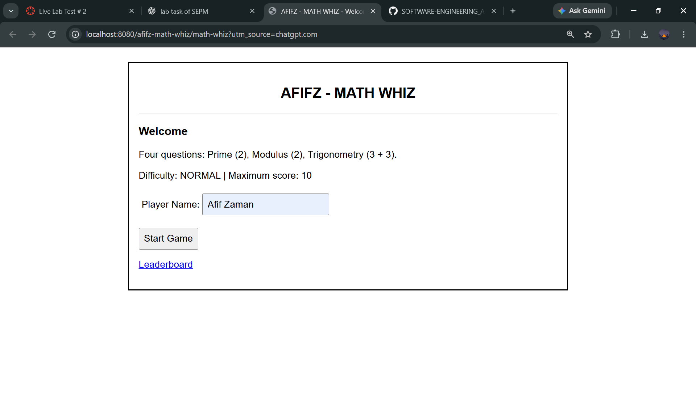
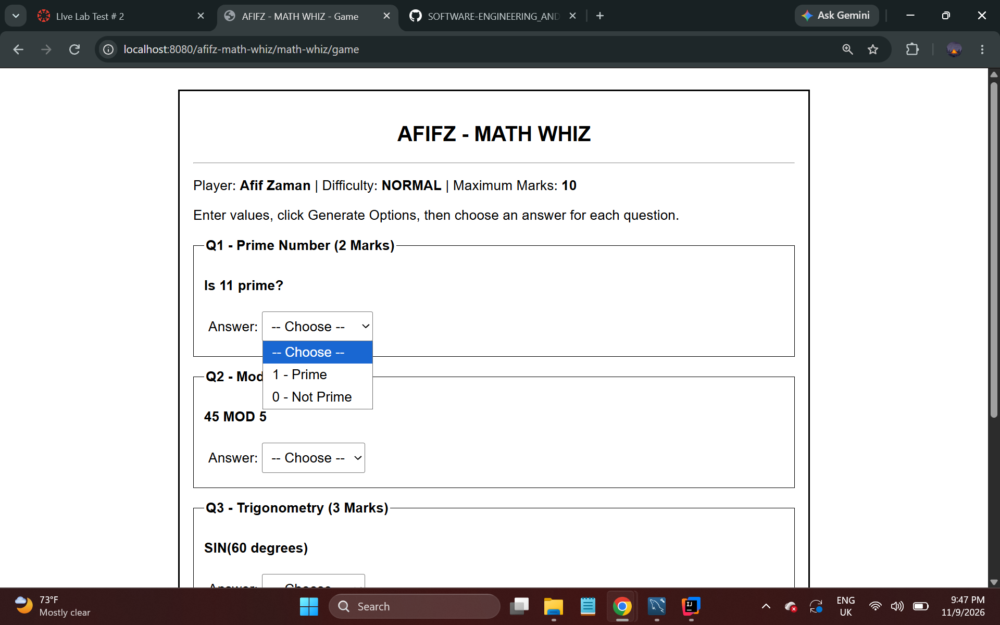
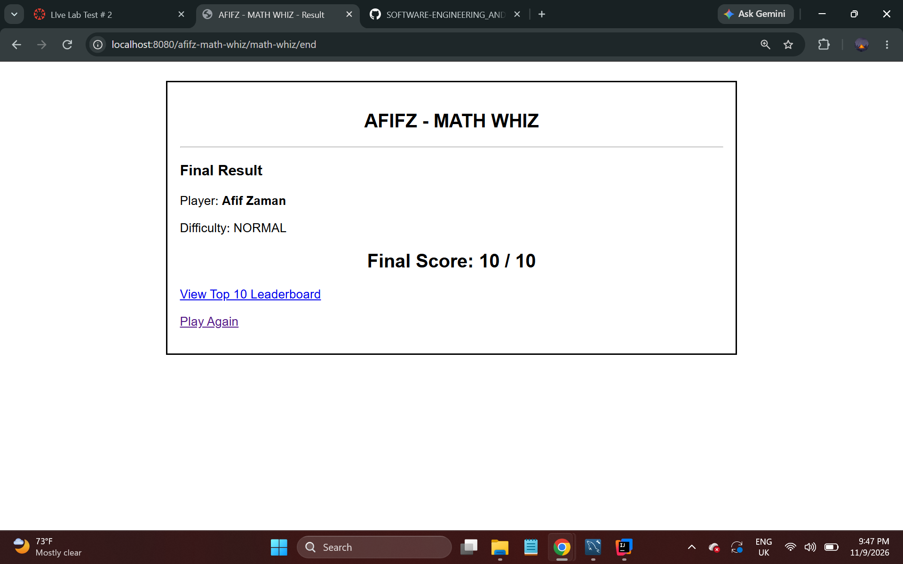
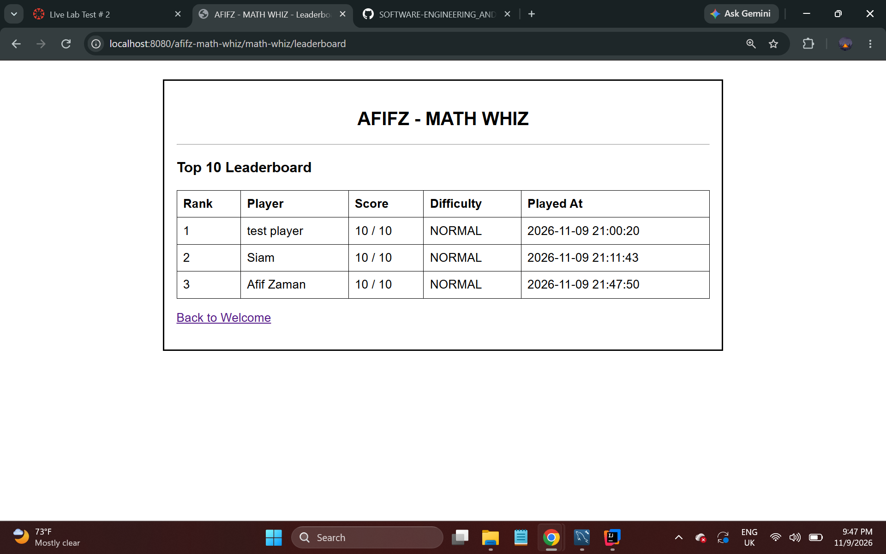

# AFIFZ MATH WHIZ

### Java Servlet-Based Mathematical Quiz Game

A web-based mathematics quiz application developed using **Java Servlets, JDBC, MySQL, Maven, and Apache Tomcat**.

---

## 1. Student Information

| Field | Details |
|---|---|
| **Student Name** | Afif Zaman |
| **Student ID** | IT23059 |
| **Course Name** | Software Engineering and Project Management |

---

## 2. Project Overview

**Afifz Math Whiz** is an interactive, web-based mathematical quiz game developed using Java Servlet technology.

The application allows players to enter their own numerical values, generate multiple-choice mathematical questions, select answers, and receive a final score based on their performance.

The game contains four questions covering three mathematical categories:

- Prime Number Identification
- Modulo Operations
- Trigonometric Calculations (SIN, COS, TAN)

Each game contains **10 marks**, and completed scores are stored in a MySQL database.

A leaderboard displays the top 10 scores.

---

## 3. Assignment Completion Checklist

✓ Java Servlet-based mathematical quiz application  
✓ Welcome page with player name input  
✓ Prime number checking method  
✓ Modulo calculation method  
✓ Sine calculation method  
✓ Cosine calculation method  
✓ Tangent calculation method  
✓ One Prime Number question worth 2 marks  
✓ One Modulo question worth 2 marks  
✓ Two Trigonometry questions worth 3 marks each  
✓ User-defined mathematical inputs  
✓ Dynamic multiple-choice answer generation  
✓ Automatic answer evaluation  
✓ Final score calculation out of 10  
✓ NORMAL difficulty level  
✓ MySQL database connectivity using JDBC  
✓ Game session management  
✓ Game score storage in MySQL  
✓ Top 10 leaderboard  
✓ Database SQL setup script  
✓ Welcome page screenshot  
✓ Game page screenshot  
✓ Result page screenshot  
✓ Leaderboard screenshot  
✓ GitHub README documentation

**Assignment Status: Completed**

---

## 4. Technologies Used

| Technology | Purpose |
|---|---|
| Java | Application logic and mathematical calculations |
| Jakarta Servlet API | Web request and response handling |
| HTML | Web page structure |
| CSS | User interface styling |
| Apache Maven | Project and dependency management |
| Apache Tomcat 11.0.24 | Web application server |
| MySQL | Database management |
| JDBC | Java-to-MySQL connectivity |
| IntelliJ IDEA Ultimate | Development environment |
| Git & GitHub | Version control and project submission |

---

## 5. Game Rules and Scoring

The game consists of four questions, worth a total of 10 marks.

| Question | Mathematical Operation | Marks |
|---|---|---|
| Question 1 | Prime Number | 2 |
| Question 2 | Modulo | 2 |
| Question 3 | Trigonometry | 3 |
| Question 4 | Trigonometry | 3 |
| **Total** | **4 Questions** | **10 Marks** |

### Game Procedure

1. The player enters their name on the welcome page.
2. The player starts the game.
3. Four mathematical question sections are displayed.
4. The player enters numerical values for each question.
5. The application generates multiple-choice options.
6. The player selects an answer for each question.
7. The player clicks **Submit All Answers**.
8. The application evaluates the submitted answers.
9. A final score out of 10 is displayed.
10. The score is stored in MySQL and can appear on the leaderboard.

**Difficulty Level:** NORMAL

---

## 6. Mathematical Methods

### 6.1 Prime Number Checking

**Method:**

`public static int isPrime(int number)`

This method determines whether a given integer is prime.

**Return values:**

- `1` — Prime Number
- `0` — Not a Prime Number

**Example:**

Input: `17`

Output: `1`

### 6.2 Modulo Calculation

**Method:**

`public static int calculateMod(int a, int b)`

This method calculates the remainder when integer `a` is divided by integer `b`.

**Example:**

Input: `17, 5`

Output: `2`

Division by zero is not permitted.

### 6.3 Trigonometric Calculations

The application supports three trigonometric functions.

**Sine:**

`public static double calculateSin(double degree)`

**Cosine:**

`public static double calculateCos(double degree)`

**Tangent:**

`public static double calculateTan(double degree)`

The application converts angles from degrees to radians before performing trigonometric calculations.

**Examples:**

| Operation | Input | Expected Result |
|---|---|---|
| SIN | 30° | 0.5 |
| COS | 60° | 0.5 |
| TAN | 45° | 1.0 |

Floating-point answers are handled using suitable rounding or tolerance. Undefined tangent values are handled separately.

---

## 7. Application Features

### 7.1 Welcome Page

The welcome page displays the game title and allows the player to enter their name before starting.

### 7.2 Game Page

The game page contains four mathematical question sections.

**Question 1 — Prime Number**

The player enters an integer and generates answer options:

- 1 — Prime
- 0 — Not Prime

**Question 2 — Modulo**

The player enters a dividend and divisor.

The application generates three possible remainder answers, including the correct answer.

**Questions 3 and 4 — Trigonometry**

For each question, the player:

- Selects SIN, COS, or TAN.
- Enters an angle in degrees.
- Generates multiple-choice options.
- Selects the answer.

### 7.3 Result Page

The result page displays the player's performance and final score out of 10.

### 7.4 Leaderboard

The leaderboard displays the top 10 game scores.

Results are ordered by:

1. Highest score first.
2. Earlier completion date first when scores are equal.

---

## 8. Database Design

The application uses a MySQL database.

**Database Name:** `project_timeline_db`

### 8.1 Table: math_whiz_games

Stores information about individual game sessions.

| Column | Description |
|---|---|
| id | Unique game identifier |
| player_name | Player name |
| total_questions | Number of answered questions |
| correct_answers | Number of correct answers |
| game_status | Game status |
| started_at | Game start time |
| ended_at | Game completion time |

### 8.2 Table: math_whiz_attempts

Stores information about submitted mathematical answers.

| Column | Description |
|---|---|
| id | Unique attempt identifier |
| game_id | Associated game identifier |
| operation | Mathematical operation |
| first_number | First numerical input |
| second_number | Second numerical input, if applicable |
| player_answer | Submitted answer |
| correct_answer | Expected answer |
| is_correct | Answer correctness |
| attempted_at | Submission timestamp |

### 8.3 Table: game_scores

Stores final scores for the leaderboard.

| Column | Description |
|---|---|
| id | Unique score identifier |
| player_name | Player name |
| score | Final score out of 10 |
| difficulty | Difficulty level |
| played_at | Date and time |

### Leaderboard SQL Query

```sql
SELECT
    player_name,
    score,
    difficulty,
    played_at
FROM game_scores
ORDER BY score DESC, played_at ASC, id ASC
LIMIT 10;
```

The complete database setup script is available at:

[`database/math_whiz.sql`](database/math_whiz.sql)

---

## 9. Project Structure

```text
Afifz-Math-Whiz/
│
├── database/
│   └── math_whiz.sql
│
├── screenshots/
│   ├── home.png
│   ├── game.png
│   ├── result.png
│   └── leaderboard.png
│
├── src/
│   └── main/
│       ├── java/
│       │   └── com/
│       │       └── assignment/
│       │           ├── DatabaseConnection.java
│       │           ├── MathWhizStartServlet.java
│       │           ├── MathWhizGameServlet.java
│       │           ├── MathWhizCheckServlet.java
│       │           ├── MathWhizEndServlet.java
│       │           ├── MathWhizLeaderboardServlet.java
│       │           └── MathWhizMathService.java
│       │
│       └── webapp/
│
├── .gitignore
├── pom.xml
└── README.md
```

---

## 10. Installation and Setup

### Prerequisites

Install the following software:

- Java JDK
- IntelliJ IDEA Ultimate or another compatible Java IDE
- Apache Maven
- Apache Tomcat 11
- MySQL Server
- MySQL Workbench

### Step 1 — Clone the Repository

```bash
git clone https://github.com/YOUR_USERNAME/Afifz-Math-Whiz.git
```

Replace `YOUR_USERNAME` with the actual GitHub username.

### Step 2 — Open the Project

1. Launch IntelliJ IDEA.
2. Select **File → Open**.
3. Select the cloned `Afifz-Math-Whiz` folder.
4. Wait for Maven dependencies to load.

### Step 3 — Configure MySQL

1. Start MySQL Server.
2. Open MySQL Workbench.
3. Open the `database/math_whiz.sql` script.
4. Execute the SQL statements.
5. Confirm the database and tables were created.

### Step 4 — Configure JDBC

Configure the database connection using the application's `DatabaseConnection` class and its required connection settings.

Ensure the database URL, username, and password match the local MySQL installation.

Do not commit database passwords or other private credentials to GitHub.

### Step 5 — Configure Apache Tomcat

1. Open **Run → Edit Configurations**.
2. Add an Apache Tomcat 11 Local Server configuration.
3. Open the **Deployment** tab.
4. Add the `afifz-math-whiz:war exploded` artifact.
5. Set the application context to `/afifz-math-whiz`.
6. Apply the configuration.

### Step 6 — Run the Application

Start Apache Tomcat.

Open the following URL in a browser:

```text
http://localhost:8080/afifz-math-whiz/math-whiz
```

---

## 11. Application Screenshots

### 11.1 Welcome Page



### 11.2 Game Page



### 11.3 Result Page



### 11.4 Leaderboard



---

## 12. Learning Outcomes

Through the development of this project, the following concepts were practiced:

✓ Java Servlet development  
✓ HTTP request and response handling  
✓ Session management  
✓ Mathematical algorithms in Java  
✓ HTML form handling  
✓ Dynamic multiple-choice question generation  
✓ Server-side answer validation  
✓ JDBC database connectivity  
✓ MySQL table design  
✓ SQL queries and result sorting  
✓ Maven project configuration  
✓ Apache Tomcat deployment  
✓ Git and GitHub project management

---

## 13. Conclusion

**Afifz Math Whiz** is a Java Servlet-based mathematical quiz application that combines mathematical problem-solving with interactive web application development.

The project demonstrates prime number identification, modulo calculations, trigonometric operations, automatic scoring, MySQL database integration, and leaderboard management.

The application was developed and tested using IntelliJ IDEA Ultimate, Apache Tomcat, Java, and MySQL.

---

**Developed By:** Afif Zaman  
**Student ID:** IT23059  
**Course:** Software Engineering and Project Management  
**Project:** AFIFZ MATH WHIZ
