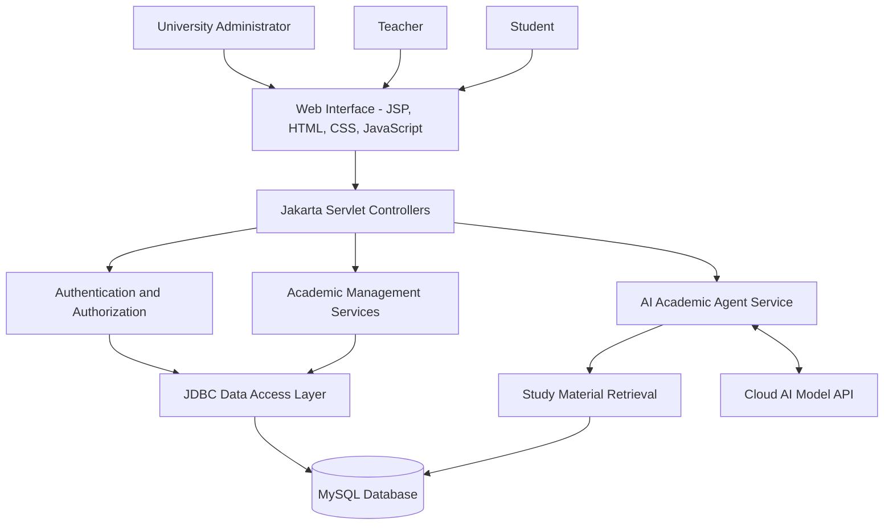
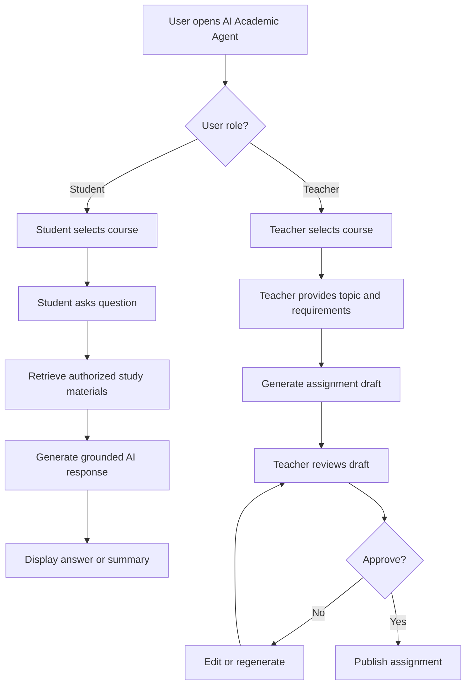
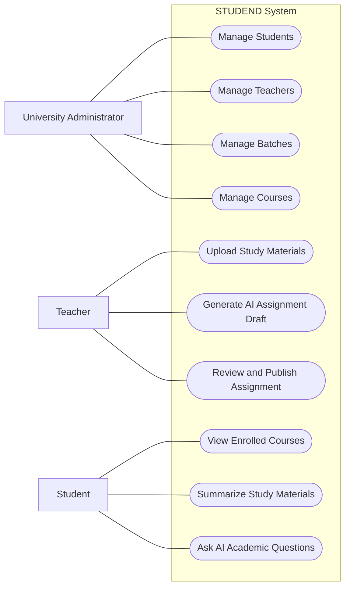
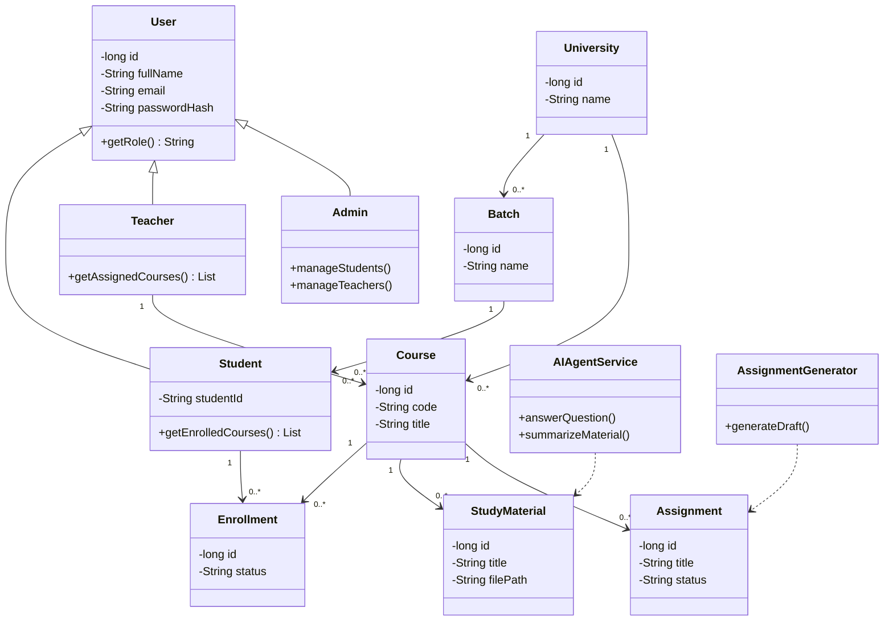
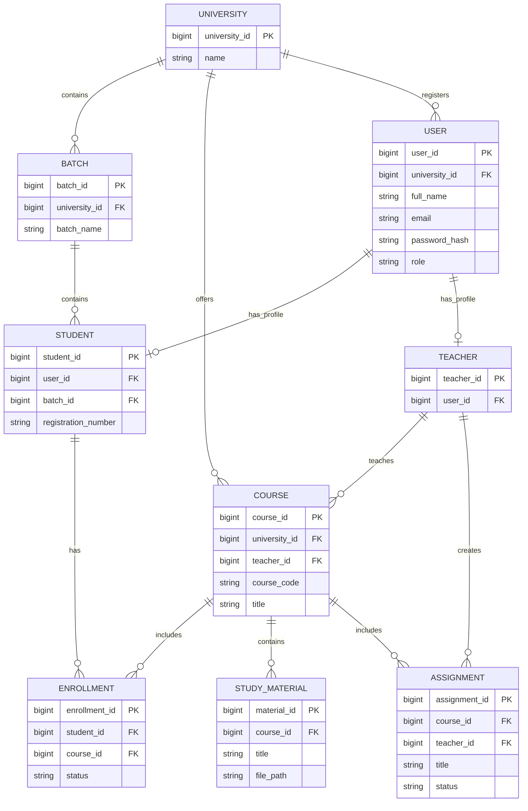
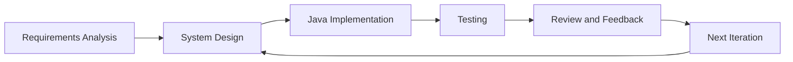
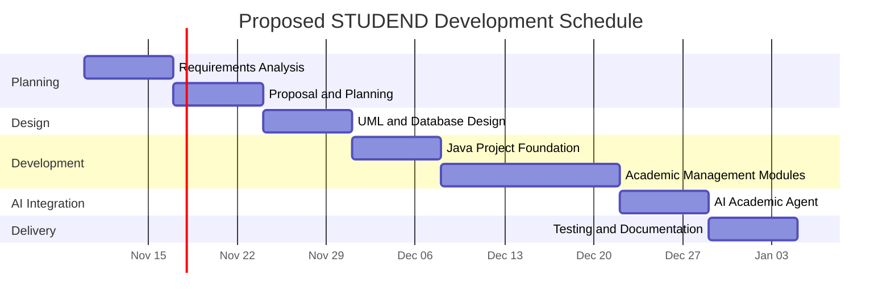

<div align="center">

# STUDEND

### AI-Powered University Academic Management and Intelligent Learning Assistance System

**Final Capstone Project — Part I: Project Proposal and Prototyping**


</div>

---

## Student and Academic Information

| Field | Information |
|---|---|
| **Student Name** | MD. Afif Zaman |
| **Student ID** | IT-23059 |
| **University** | Mawlana Bhashani Science and Technology University |
| **Course** | Software Engineering and Project Management |
| **Course Teacher** | Prof. Dr. Ziaur Rahman |
| **Assignment** | Part I — Final Capstone Project Proposal and Prototyping |
| **Proposal Version** | 1.0 |
| **Submission Year** | 2026 |

---

## Project Documentation

| Document | Link |
|---|---|
| Complete Project Proposal | [View PDF](STUDEND_Capstone_Proposal_V1_0.pdf) |
| Editable LaTeX Source | [View LaTeX](STUDEND_Capstone_Proposal_V1_0.tex) |

The project proposal includes the requirements specification, software process model, development schedule, milestones, Gantt chart, and system design diagrams.

---

## 1. Project Overview

**STUDEND** is a proposed Java-based academic management system that integrates university administration, course management, academic resources, and artificial intelligence into a centralized web application.

The platform is designed to support three primary user roles:

- **University Administrator:** Manages students, teachers, batches, courses, and academic operations.
- **Teacher:** Manages assigned courses, uploads study materials, creates assignments, and uses AI-assisted assessment generation.
- **Student:** Accesses enrolled courses, studies uploaded materials, and interacts with an AI-powered learning assistant.

The system aims to improve academic organization, reduce repetitive administrative tasks, and provide personalized learning support.

### Core Innovation

STUDEND combines traditional academic management with a cloud-based AI Academic Agent.

Students will be able to ask questions about course materials and generate study summaries, while teachers will be able to generate assignment drafts using artificial intelligence.

---

## 2. Problem Statement

Many universities rely on multiple disconnected systems for managing academic activities.

This can create several challenges:

1. Fragmented student and teacher information.
2. Inefficient course and batch management.
3. Difficulty accessing organized study materials.
4. Time-consuming assignment preparation.
5. Limited personalized academic assistance.
6. Repetitive administrative operations.
7. Lack of centralized academic workflows.

STUDEND proposes a unified platform that addresses these challenges through structured academic management and intelligent learning assistance.

---

## 3. Project Objectives

The major objectives of STUDEND are:

1. Develop a centralized university academic management system.
2. Implement secure role-based authentication.
3. Manage students, teachers, batches, and courses.
4. Provide dedicated dashboards for each user role.
5. Support academic material uploading and retrieval.
6. Integrate an AI-powered student learning assistant.
7. Support AI-assisted assignment generation for teachers.
8. Store academic information in a relational database.
9. Apply object-oriented software engineering principles.
10. Develop a working Java prototype demonstrating the system.

---

## 4. Proposed Technology Stack

| Component | Technology |
|---|---|
| Programming Language | Java 25 |
| Backend | Jakarta Servlets |
| Frontend | JSP, HTML, CSS, JavaScript |
| Database | MySQL |
| Database Connectivity | JDBC |
| Application Server | Apache Tomcat 11 |
| Build Tool | Maven |
| Development IDE | IntelliJ IDEA Ultimate |
| AI Integration | Cloud-based Language Model API |
| API Communication | Java HTTP Client |
| Documentation | LaTeX |
| Diagrams | UML, Mermaid |
| Version Control | Git and GitHub |

---

## 5. System Architecture

STUDEND will follow a layered architecture separating the presentation layer, application logic, data access, and AI services.



### Architecture Description

**Presentation Layer**

Provides user interfaces for administrators, teachers, and students.

**Controller Layer**

Jakarta Servlets process incoming HTTP requests and coordinate application services.

**Business Logic Layer**

Handles academic management operations, validation, and access control.

**Data Access Layer**

JDBC repositories manage communication with the MySQL database.

**AI Integration Layer**

Communicates with the cloud AI API and retrieves authorized study materials to support contextual responses.

---

## 6. Core Functional Modules

### 6.1 University Administration

The university administrator will be able to:

- Manage student accounts.
- Manage teacher accounts.
- Create and maintain academic batches.
- Create courses.
- Assign teachers to courses.
- Assign batches to courses.
- View academic management information.

### 6.2 Teacher Dashboard

Teachers will be able to:

- View assigned courses.
- Upload course materials.
- Create assignments.
- Generate assignment drafts using AI.
- Review AI-generated questions.
- Approve and publish assignments.

### 6.3 Student Dashboard

Students will be able to:

- View enrolled courses.
- Access course materials.
- Read assignment instructions.
- Ask questions about study materials.
- Generate lecture summaries.
- Request topic explanations and practice questions.

---

## 7. AI Academic Agent

The AI Academic Agent is the primary intelligent component of STUDEND.

### 7.1 Student AI Assistant

The student AI assistant will support:

- Lecture summarization.
- Document-based question answering.
- Topic explanations.
- Revision note generation.
- Practice question generation.
- Course-specific academic assistance.

The system will retrieve relevant course materials before requesting an answer from the cloud AI model.

When the materials do not contain enough information, the assistant should indicate the limitation instead of inventing unsupported answers.

### 7.2 Teacher AI Assignment Generator

The teacher AI assistant will support:

- Assignment question generation.
- Multiple-choice question generation.
- Short-answer question generation.
- Descriptive question generation.
- Suggested marking rubrics.
- Difficulty selection.
- Assignment draft editing.

Teachers will retain control over all generated assignments.

### AI Workflow Diagram



---

## 8. Use Case Diagram

The following diagram illustrates the major interactions between the system and its primary actors.



This is a Mermaid representation of the use cases. The formal UML diagrams are provided in the project proposal.

---

## 9. Object-Oriented Class Design

The Java application will use classes representing academic entities and supporting services.

### Proposed Classes

| Class | Responsibility |
|---|---|
| `User` | Common user information |
| `Student` | Student identity and academic details |
| `Teacher` | Teacher information |
| `Admin` | Administrative user |
| `University` | University information |
| `Batch` | Academic batch |
| `Course` | Academic course |
| `Enrollment` | Student-course relationship |
| `StudyMaterial` | Uploaded academic resource |
| `Assignment` | Academic assignment |
| `Question` | Assignment question |
| `AIAgentService` | AI communication and orchestration |
| `AssignmentGenerator` | AI assignment draft generation |

### Class Diagram



The diagram represents the proposed initial design. Relationships and methods may be refined during Java implementation.

---

## 10. Entity Relationship Diagram

The database will use MySQL to store academic and application information.



This ER diagram is a preliminary logical model. The final schema will include additional constraints and relationships as required.

---

## 11. Software Development Process Model

STUDEND will follow the **Iterative and Incremental Software Development Model**.

The system will be developed through successive iterations, with each iteration adding functionality and allowing testing and feedback.

### Development Process Diagram



### Reasons for Selecting This Model

- Supports gradual development.
- Allows early prototype demonstrations.
- Reduces implementation complexity.
- Enables continuous testing.
- Accommodates requirement changes.
- Supports independent development of AI modules.

---

## 12. Project Schedule and Milestones

The proposed development schedule covers eight weeks.

| Week | Activities | Deliverables |
|---|---|---|
| 1 | Requirements analysis | Requirements specification |
| 2 | Project planning and proposal | Project proposal |
| 3 | UML diagrams and database design | System design documentation |
| 4 | Java project setup and authentication | Application foundation |
| 5 | Student, teacher, and batch management | Core management modules |
| 6 | Course and material management | Academic prototype |
| 7 | AI integration and testing | AI demonstration |
| 8 | Final testing and documentation | Prototype and final repository |

### Gantt Chart



The schedule is illustrative and may be adjusted according to the academic project timeline.

---

## 13. Security and Responsible AI

STUDEND will follow secure software development practices.

Planned security measures include:

- Password hashing.
- Role-based authorization.
- Secure session management.
- Prepared SQL statements.
- Server-side input validation.
- Protection against unauthorized course access.
- Secure storage of API credentials.
- Restricted access to unpublished assignments.
- Controlled study material retrieval.

AI-generated responses may contain errors and must not be treated as authoritative without verification.

Teachers will review AI-generated assignments before publication.

---

## 14. Testing Strategy

| Testing Method | Purpose |
|---|---|
| Unit Testing | Verify Java classes and methods |
| Integration Testing | Validate module interactions |
| Database Testing | Test JDBC operations |
| Functional Testing | Verify academic workflows |
| Authentication Testing | Validate access restrictions |
| AI Response Testing | Evaluate relevance and correctness |
| Security Testing | Identify authorization and input issues |
| User Acceptance Testing | Evaluate usability |

Testing evidence and screenshots will be added as implementation progresses.

---

## 15. Project Repository Structure

The project is maintained within the existing Software Engineering and Project Management repository.

```text
SOFTWARE-ENGINEERING_AND_PROJECT-MANAGEMENT/
└── ASSIGNMENTS/
    └── Project Proposal and Prototyping/
        ├── README.md
        ├── STUDEND_Capstone_Proposal_V1_0.pdf
        ├── STUDEND_Capstone_Proposal_V1_0.tex
        │
        └── Planned Future Additions/
            ├── Java Application Source
            ├── Database Schema
            ├── Prototype Screenshots
            └── Testing Reports
```

The future additions listed above are planned and are not currently part of the completed proposal submission.

---

## 16. Current Development Status

| Component | Status |
|---|---|
| Project Concept | Completed |
| Requirements Analysis | Completed |
| Project Proposal | Completed |
| Software Process Model | Completed |
| UML Design Documentation | Completed |
| Gantt Chart | Completed |
| Java Project Setup | Planned |
| Database Implementation | Planned |
| Role-Based Dashboards | Planned |
| AI Academic Agent | Planned |
| Prototype Testing | Planned |

**Current Project Stage:** Proposal and Initial System Design

---

## 17. Expected Outcomes

Upon completion, STUDEND is expected to provide:

1. A centralized academic management platform.
2. Role-based academic dashboards.
3. Organized student, teacher, batch, and course management.
4. Structured academic material access.
5. AI-assisted learning support.
6. AI-supported assignment preparation.
7. Secure relational database integration.
8. A modular Java web application architecture.
9. A documented and tested academic management prototype.

---

## 18. Future Enhancements

Potential future development includes:

- Attendance management.
- Examination and grading management.
- Timetable management.
- Excel-based bulk imports.
- Academic performance analytics.
- Improved retrieval-augmented AI assistance.
- Notifications and announcements.
- Multi-university support.
- Advanced administrative reporting.
- Mobile-responsive enhancements.

---

## 19. Academic Integrity and Project Scope

This repository documents an individual academic capstone project.

The proposal describes the intended system architecture, functionality, and development approach.

Features marked as planned are not represented as completed implementations.

AI-assisted content will be subject to human review, particularly in academic assessment workflows.

---

<div align="center">

## STUDEND

**Intelligent Academic Management and Learning Assistance**

**Developed by MD. Afif Zaman**  
**Student ID: IT-23059**

Mawlana Bhashani Science and Technology University

Software Engineering and Project Management

**Course Teacher: Prof. Dr. Ziaur Rahman**

**Project Proposal — Version 1.0**

</div>
