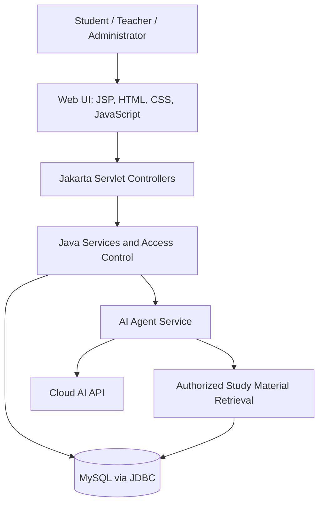

<div align="center">

# 🎓 STUDEND

### AI-Powered University Academic Management & Intelligent Learning Assistance System

**A Java-based capstone project combining academic administration with course-aware AI assistance.**


[📘 Read Proposal](docs/proposal/STUDEND_Capstone_Proposal_V1_0.pdf) · [📝 LaTeX Source](docs/proposal/STUDEND_Capstone_Proposal_V1_0.tex) · [🗺️ Roadmap](#-development-roadmap) · [🧩 System Design](#-system-design--diagrams)

</div>

---

**Location in course repository:** `ASSIGNMENTS/Project Proposal and Prototyping/`

## ✨ The Vision

University academic information is often scattered across different tools, files, and communication channels. **STUDEND** proposes one role-based platform where administrators organize academic operations, teachers manage courses and assessments, and students access learning resources and support.

Its distinguishing capability is an **AI Academic Agent** designed to work with authorized course materials: students can request explanations and summaries, while teachers can generate **editable assignment drafts**. Teachers remain responsible for reviewing and publishing assessments.

> **Project status:** This assignment folder currently contains the **Part I capstone proposal and design documentation**. The Java prototype, AI integration, and demonstrations are planned deliverables, **not yet implemented or verified** in this assignment folder.

## 🚀 Planned Capabilities

| 👤 Role | Academic workspace | AI-assisted workflow |
|:--|:--|:--|
| **Student** | View enrolled courses, materials, and academic activities | Ask questions grounded in accessible materials, summarize lectures, prepare revision notes |
| **Teacher** | Manage course materials and assignments | Generate draft questions, assignment outlines, and suggested rubrics for review |
| **University administrator** | Manage students, teachers, batches, courses, and enrollment | Oversee access and academic operations |

### 🤖 AI Academic Agent

**Student experience**
1. Open a course and select an available study resource.
2. Ask a question or request a summary.
3. The backend retrieves authorized, relevant material and sends necessary context to a cloud AI API.
4. The assistant responds with a course-grounded explanation and identifies uncertainty where appropriate.

**Teacher experience**
1. Select a course, topic, and assignment requirements.
2. Request an AI-generated draft.
3. Review and edit the draft and marking rubric.
4. **Approve and publish manually**—AI does not publish assignments autonomously.

**Design safeguards:** role-based access, server-side API credentials, restricted retrieval, minimal data disclosure, review of AI output, and explicit handling of inaccurate or unsupported responses.

## 🧰 Proposed Technology Stack

| Layer | Planned technology |
|---|---|
| Programming language | Java |
| Web application | Jakarta Servlets, JSP, HTML, CSS, JavaScript |
| Application server | Apache Tomcat 11 |
| Database | MySQL |
| Data access | JDBC |
| Build and dependencies | Maven |
| AI integration | Cloud language-model API via Java service layer |
| Diagrams and design | UML, DFD, ERD, LaTeX |
| Source control | Git & GitHub |

The implementation will be a **separate Java project**; the existing Django-based STUDEND prototype is not represented as Java source code here.

## 🏗️ Proposed Architecture



The architecture separates the user interface, application rules, data access, and AI integration so that features can be developed and tested incrementally.

## 🧩 System Design & Diagrams

The **proposal PDF** includes the required system-design artifacts:

- **Data Flow Diagram (Level 0 / Context):** external actors and information exchange.
- **Use Case Diagram:** student, teacher, and administrator interactions.
- **Activity Diagram:** teacher AI-assisted assignment workflow.
- **Entity Relationship Diagram:** proposed database entities and relationships.
- **Class Diagram:** initial Java domain and service model.
- **Object Diagram:** illustrative instances and relationships.

It also contains the **Gantt chart**, requirements, software process model, milestones, risks, feasibility, testing plan, and prototype scope.

📄 **[View the full 19-page capstone proposal (PDF)](docs/proposal/STUDEND_Capstone_Proposal_V1_0.pdf)**

## 🗓️ Development Roadmap

The proposal uses an **Iterative and Incremental** process model. The following is a *planned* eight-week sequence, not a report of completed work.

| Phase | Target window | Expected deliverable |
|---|---|---|
| Requirements & proposal | Weeks 1–2 | Requirements baseline and project proposal |
| UML & data design | Weeks 2–3 | Diagrams and relational schema |
| Java foundation | Week 3 | Maven project, database connection, base navigation |
| Core academic modules | Weeks 4–6 | Role-based CRUD prototype with five or more domain classes |
| AI agent demonstration | Weeks 5–6 | Material-grounded Q&A and teacher-reviewed assignment drafts |
| Testing & documentation | Weeks 7–8 | Test results, screenshots, README, final repository |

## 📂 Assignment Folder Structure

```text
SOFTWARE-ENGINEERING_AND_PROJECT-MANAGEMENT/
└── ASSIGNMENTS/
    └── Project Proposal and Prototyping/
        ├── README.md
        ├── .gitignore
        ├── docs/
        │   ├── proposal/
        │   │   ├── STUDEND_Capstone_Proposal_V1_0.pdf
        │   │   └── STUDEND_Capstone_Proposal_V1_0.tex
        │   └── diagrams/          # Future standalone diagram exports
        └── src/                   # Future Java Maven application
```

## 🧪 Planned Validation

The prototype will be evaluated through role-based authorization tests, student/teacher/course CRUD tests, database integrity checks, document-access restrictions, AI answer grounding checks, and teacher approval of generated assignments. AI responses will be assessed for correctness and unsupported claims rather than assumed reliable.

## 📚 Capstone Submission

**Assignment:** Part I — Final Capstone Project Proposal and Prototyping  
**Course:** Software Engineering and Project Management  
**Proposal version:** 1.0  
**Submission format:** Existing course GitHub repository URL (link to this assignment folder)

This assignment folder currently provides the **proposal artifact**. The assignment also requests a **working interface using at least five classes**; that requirement will be met only after the Java prototype is developed and committed.

## 👨‍🎓 Academic Information

| | |
|---|---|
| **Prepared by** | MD. Afif Zaman |
| **Student ID** | IT-23059 |
| **University** | Mawlana Bhashani Science and Technology University |
| **Course teacher** | Prof. Dr. Ziaur Rahman |

---

<div align="center">

### STUDEND — Organize academics. Empower learning.

*Part I capstone proposal and prototyping — course assignment folder.*

</div>
