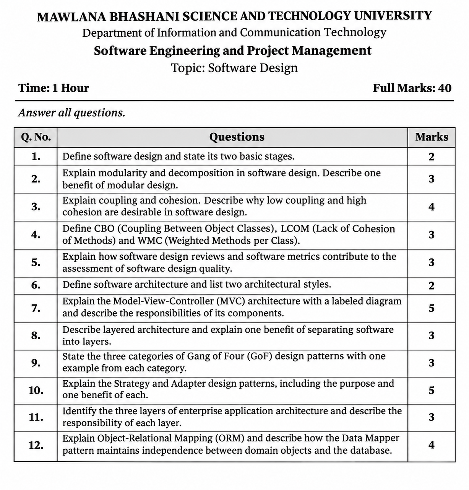
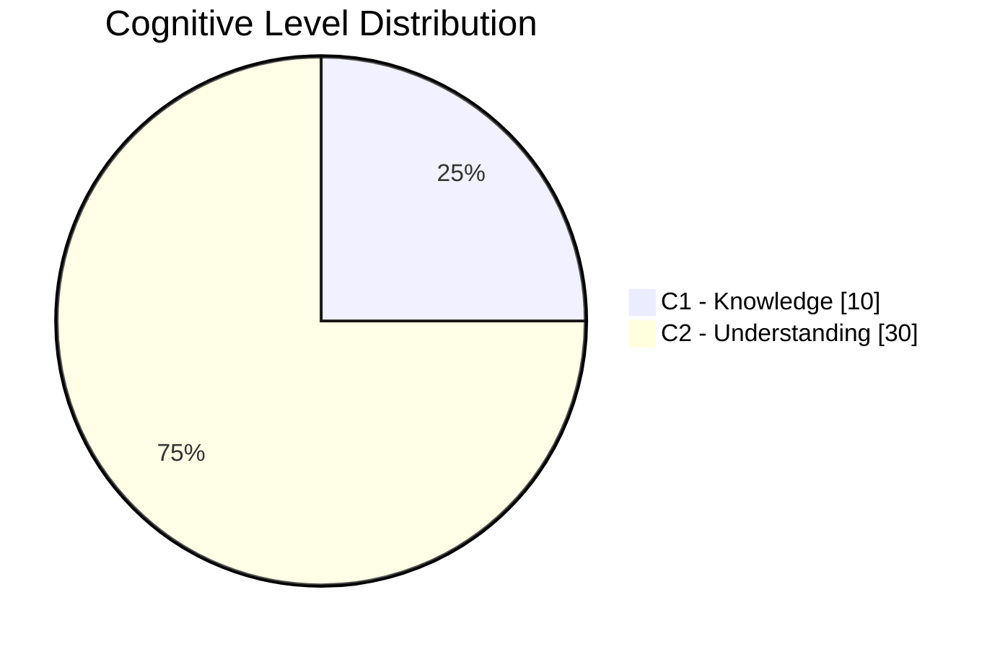
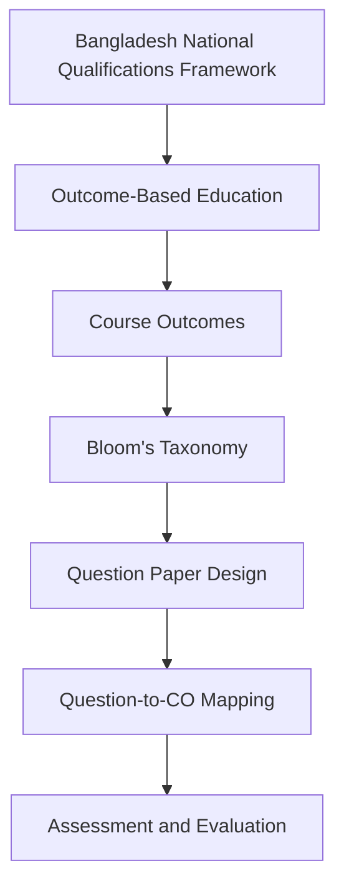

# Assignment: OBE-Based Question Paper Design 

## Student Information

| Field | Details |
|---|---|
| Student Name | Afif Zaman |
| Student ID | IT23059 |

---

## Question Paper

  

---

## 1. Assessment Overview

This assignment presents an Outcome-Based Education (OBE) question paper based on the Software Design lecture material, incorporating Bloom's Taxonomy and the principles of the Bangladesh National Qualifications Framework (BNQF).

| Assessment Parameter | Specification |
|---|---|
| Assessment Type | Written Examination |
| Educational Approach | Outcome-Based Education (OBE) |
| Qualification Framework | BNQF |
| Learning Domain | Cognitive |
| Cognitive Levels | C1 and C2 |
| Number of Questions | 12 |
| Number of Course Outcomes | 5 |
| Total Marks | 40 |
| Examination Duration | 60 Minutes |
| Question Selection | All Questions Compulsory |

---

## 2. Software Engineering Course Outcomes (COs)

Upon completion of the assessed learning material, students should be able to achieve the following course outcomes:

| CO | Course Outcome |
|:---:|---|
| CO1 | Describe fundamental software design concepts and explain modularity, coupling and cohesion. |
| CO2 | Identify software design quality metrics and explain their significance in assessing software design quality. |
| CO3 | Identify software architectural styles and explain their structures and responsibilities. |
| CO4 | Classify object-oriented design patterns and explain their purposes and benefits. |
| CO5 | Describe enterprise application architecture and explain object-relational mapping and data mapping patterns. |

These course outcomes are proposed based on the supplied Software Design lecture material.

---

## 3. Bloom's Taxonomy

Bloom's Taxonomy provides a framework for classifying educational learning objectives according to their cognitive complexity.

### Cognitive Domain

| Level | Cognitive Category | Action Verbs | Assessment Status |
|:---:|---|---|---|
| C1 | Remembering (Knowledge) | Define, List, State, Identify | Included |
| C2 | Understanding | Explain, Describe, Summarize | Included |
| C3 | Applying | Apply, Calculate, Demonstrate | Not Included |
| C4 | Analyzing | Analyze, Examine, Differentiate | Not Included |
| C5 | Evaluating | Evaluate, Justify, Assess | Not Included |
| C6 | Creating | Design, Develop, Construct | Not Included |

### Selected Cognitive Levels

#### C1 — Knowledge / Remembering

Measures students' ability to recall previously learned facts, definitions, concepts and classifications.

#### C2 — Understanding

Measures students' ability to explain concepts, describe relationships and demonstrate conceptual understanding.

The assessment focuses exclusively on these two cognitive levels according to the assignment requirements.

---

## 4. Question-to-CO and Bloom's Taxonomy Mapping

| Question | Assessment Topic | CO | Bloom's Level | Marks |
|:---:|---|:---:|:---:|:---:|
| Q1 | Software Design Fundamentals | CO1 | C1 | 2 |
| Q2 | Modularity and Decomposition | CO1 | C2 | 3 |
| Q3 | Coupling and Cohesion | CO1 | C2 | 4 |
| Q4 | Software Design Quality Metrics | CO2 | C1 | 3 |
| Q5 | Software Design Quality Assessment | CO2 | C2 | 3 |
| Q6 | Software Architecture | CO3 | C1 | 2 |
| Q7 | MVC Architecture | CO3 | C2 | 5 |
| Q8 | Layered Architecture | CO3 | C2 | 3 |
| Q9 | GoF Design Pattern Classification | CO4 | C1 | 3 |
| Q10 | Strategy and Adapter Patterns | CO4 | C2 | 5 |
| Q11 | Enterprise Application Architecture | CO5 | C2 | 3 |
| Q12 | ORM and Data Mapper | CO5 | C2 | 4 |
| | **Total** | | | **40** |

---

## 5. Course Outcome Mapping Matrix

| Question | CO1 | CO2 | CO3 | CO4 | CO5 | Marks |
|:---:|:---:|:---:|:---:|:---:|:---:|:---:|
| Q1 | 2 | — | — | — | — | 2 |
| Q2 | 3 | — | — | — | — | 3 |
| Q3 | 4 | — | — | — | — | 4 |
| Q4 | — | 3 | — | — | — | 3 |
| Q5 | — | 3 | — | — | — | 3 |
| Q6 | — | — | 2 | — | — | 2 |
| Q7 | — | — | 5 | — | — | 5 |
| Q8 | — | — | 3 | — | — | 3 |
| Q9 | — | — | — | 3 | — | 3 |
| Q10 | — | — | — | 5 | — | 5 |
| Q11 | — | — | — | — | 3 | 3 |
| Q12 | — | — | — | — | 4 | 4 |
| **Total** | **9** | **6** | **10** | **8** | **7** | **40** |

### CO-wise Marks Distribution

| Course Outcome | Allocated Marks | Weight |
|:---:|:---:|:---:|
| CO1 | 9 | 22.5% |
| CO2 | 6 | 15% |
| CO3 | 10 | 25% |
| CO4 | 8 | 20% |
| CO5 | 7 | 17.5% |
| **Total** | **40** | **100%** |

The marks are distributed according to the scope and complexity of the assessed topics rather than assigning equal marks to every course outcome.

---

## 6. Table of Specification (TOS)

The Table of Specification establishes the relationship between course outcomes, cognitive levels and allocated marks.

| Course Outcome | C1 — Knowledge | C2 — Understanding | Total Marks | Weight |
|:---:|:---:|:---:|:---:|:---:|
| CO1 | 2 | 7 | 9 | 22.5% |
| CO2 | 3 | 3 | 6 | 15% |
| CO3 | 2 | 8 | 10 | 25% |
| CO4 | 3 | 5 | 8 | 20% |
| CO5 | 0 | 7 | 7 | 17.5% |
| **Total** | **10** | **30** | **40** | **100%** |

---

## 7. Cognitive Level Distribution

| Cognitive Level | Number of Questions | Marks | Percentage |
|---|:---:|:---:|:---:|
| C1 — Knowledge | 4 | 10 | 25% |
| C2 — Understanding | 8 | 30 | 75% |
| C3 — Applying | 0 | 0 | 0% |
| C4 — Analyzing | 0 | 0 | 0% |
| C5 — Evaluating | 0 | 0 | 0% |
| C6 — Creating | 0 | 0 | 0% |
| **Total** | **12** | **40** | **100%** |

### Graphical Representation

The assessment emphasizes conceptual understanding while retaining knowledge-based questions to evaluate fundamental concepts.

---

## 8. Examination Time Distribution

The examination duration is 60 minutes. Answering time is estimated according to the complexity, allocated marks and expected answer length of each question.

| Question | Marks | Estimated Answering Time |
|:---:|:---:|:---:|
| Q1 | 2 | 2 Minutes |
| Q2 | 3 | 4 Minutes |
| Q3 | 4 | 6 Minutes |
| Q4 | 3 | 4 Minutes |
| Q5 | 3 | 4 Minutes |
| Q6 | 2 | 2 Minutes |
| Q7 | 5 | 8 Minutes |
| Q8 | 3 | 4 Minutes |
| Q9 | 3 | 3 Minutes |
| Q10 | 5 | 8 Minutes |
| Q11 | 3 | 4 Minutes |
| Q12 | 4 | 6 Minutes |
| **Answering Time** | **40** | **55 Minutes** |
| Reading and Revision | — | 5 Minutes |
| **Total Duration** | **40** | **60 Minutes** |

### Time Allocation Summary

| Activity | Duration |
|---|:---:|
| Knowledge-Based Questions | 11 Minutes |
| Understanding-Based Questions | 44 Minutes |
| Reading and Revision | 5 Minutes |
| **Total** | **60 Minutes** |

The estimated duration assumes that students are adequately prepared and provide concise, relevant answers.

---

## 9. Assessment Marking Rubric

The marking rubric provides a structured method for evaluating student responses consistently.

| Question | Evaluation Criteria | Marks |
|:---:|---|:---:|
| Q1 | Correct definition of software design | 1 |
| | Identification of its two basic stages | 1 |
| Q2 | Explanation of modularity | 1 |
| | Explanation of decomposition | 1 |
| | Description of one benefit | 1 |
| Q3 | Explanation of coupling | 1 |
| | Explanation of cohesion | 1 |
| | Importance of low coupling | 1 |
| | Importance of high cohesion | 1 |
| Q4 | Correct definition of CBO | 1 |
| | Correct definition of LCOM | 1 |
| | Correct definition of WMC | 1 |
| Q5 | Explanation of software design reviews | 1.5 |
| | Explanation of software design metrics | 1.5 |
| Q6 | Correct definition of software architecture | 1 |
| | Identification of two architectural styles | 1 |
| Q7 | Explanation of MVC architecture | 1 |
| | Responsibility of Model | 1 |
| | Responsibility of View | 1 |
| | Responsibility of Controller | 1 |
| | Correct labeled diagram | 1 |
| Q8 | Description of layered architecture | 2 |
| | Explanation of one benefit | 1 |
| Q9 | Creational pattern category with example | 1 |
| | Structural pattern category with example | 1 |
| | Behavioral pattern category with example | 1 |
| Q10 | Explanation and purpose of Strategy pattern | 1.5 |
| | One benefit of Strategy pattern | 1 |
| | Explanation and purpose of Adapter pattern | 1.5 |
| | One benefit of Adapter pattern | 1 |
| Q11 | Presentation layer and its responsibility | 1 |
| | Business or domain layer and its responsibility | 1 |
| | Data source layer and its responsibility | 1 |
| Q12 | Explanation of Object-Relational Mapping | 2 |
| | Explanation of Data Mapper and independence | 2 |
| | **Total Marks** | **40** |

Equivalent technically correct answers should receive appropriate credit.

---

## 10. BNQF and OBE Alignment

### Bangladesh National Qualifications Framework (BNQF)

BNQF establishes national standards for educational qualifications and expected learning outcomes in Bangladesh. It emphasizes knowledge, skills and competencies appropriate to different qualification levels.

### Outcome-Based Education (OBE)

Outcome-Based Education focuses on measurable learning outcomes that students are expected to achieve after completing a learning experience.

### Assessment Design Framework

### Assessment Alignment

| Principle | Implementation |
|---|---|
| Measurable Learning Outcomes | Five proposed course outcomes |
| Cognitive Assessment | Knowledge and Understanding |
| Outcome Mapping | Every question mapped to a CO |
| Cognitive Mapping | Every question mapped to a Bloom's level |
| Assessment Transparency | Defined marks and marking rubric |
| Time Feasibility | 60-minute examination plan |
| Content Alignment | Questions based on Software Design lecture material |

The assessment adopts an outcome-oriented approach appropriate for undergraduate education.

The selected cognitive levels, marks distribution and course outcomes are assignment-specific proposals rather than mandatory BNQF requirements. Formal alignment requires verification against the approved curriculum and applicable BNQF descriptors.

---

## 11. Course Outcome Attainment

Individual course outcome attainment can be estimated using the marks obtained in questions mapped to each course outcome.

### Formula

$$
\text{CO Attainment} =
\frac{\text{Obtained CO Marks}}
{\text{Allocated CO Marks}}
\times 100\%
$$

### Illustrative Example

| Course Outcome | Allocated Marks | Obtained Marks | Attainment |
|:---:|:---:|:---:|:---:|
| CO1 | 9 | 7 | 77.78% |
| CO2 | 6 | 5 | 83.33% |
| CO3 | 10 | 8 | 80% |
| CO4 | 8 | 6 | 75% |
| CO5 | 7 | 5 | 71.43% |
| **Total** | **40** | **31** | **77.5%** |

These values are hypothetical and demonstrate the calculation of individual course outcome attainment.

Actual course-level attainment should follow the institution's approved OBE assessment policy.

---

## 12. Assessment Design Justification

### Outcome Alignment

Each question is mapped to a specific course outcome to ensure that the assessment measures identifiable learning objectives.

### Cognitive Alignment

The questions use measurable action verbs corresponding to the Knowledge and Understanding levels of Bloom's Taxonomy.

### Marks Distribution

Marks are allocated according to the complexity and expected depth of each response.

### Time Feasibility

The examination is designed with an estimated answering time of 55 minutes and an additional 5 minutes for reading and revision.

### Assessment Transparency

The question mapping matrix, Table of Specification and marking rubric establish a structured and transparent evaluation process.

---

## 13. Conclusion

This assignment presents a 40-mark Outcome-Based Education assessment for Software Engineering, designed to be completed within one hour.

The question paper consists of 12 compulsory questions mapped to five proposed course outcomes and two cognitive levels of Bloom's Taxonomy.

The assessment allocates 25% of the total marks to Knowledge and 75% to Understanding.

The incorporation of course outcome mapping, cognitive level classification, time distribution and a marking rubric provides a structured, measurable and outcome-oriented assessment approach.

---

## 14. References

1. [Software Design Lecture Material](./SoftEng-Design.pdf).
2. Bangladesh National Qualifications Framework (BNQF).
3. Bloom, B. S. et al. (1956). Taxonomy of Educational Objectives.
4. Anderson, L. W., and Krathwohl, D. R. (2001). A Taxonomy for Learning, Teaching, and Assessing.
5. IEEE Software Engineering Body of Knowledge (SWEBOK), Version 3.
6. Ian Sommerville — Software Engineering.
7. Gamma, Helm, Johnson and Vlissides — Design Patterns.
8. Martin Fowler — Patterns of Enterprise Application Architecture.

---

